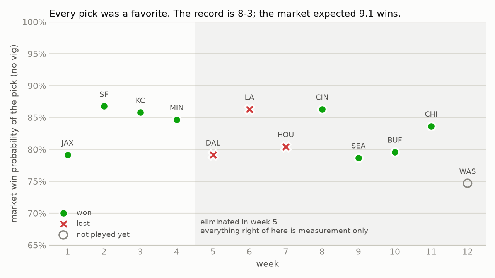

# nfl-survivor

> How far does picking the market's biggest favorite carry you in an NFL survivor pool?



## The story

**The question.** In a survivor pool you pick one team a week, never the same
team twice, and one loss ends your season. The obvious rule is greedy: each
week, take the biggest favorite on the board that you haven't used yet. How far
does that get you?

**What I found.** Not far: **week 5**. DAL, a 79% favorite at home against
Tampa Bay, lost 24–16, and the rule was out. That was not bad luck. Every pick
was a favorite of between 75% and 87%, and those numbers multiply. Chained
together, the market's own prices gave the rule a **50% chance of surviving
week 4** and a **40% chance of surviving week 5**. Getting knocked out early
was always the most likely outcome.

Treated as a measurement and kept running after the elimination, the rule is
**8-3** through week 11, against the **9.1 wins** the market expected. The
favorites won about as often as their prices said they would. That is exactly
the problem: in a survivor pool, an 83% favorite still costs you your season
one week in six.

**Why it matters.** "Just take the biggest favorite" sounds like the safe play,
and for any *single* week it is. But survival is a product, not an average:
eleven straight 83% picks give you a **12%** chance of reaching week 12 alive.
The greedy rule also spends its best teams early. JAX was used up in week 1 at
79%. In week 12 JAX is an 89% favorite, and the rule is left with WAS at 75%,
its weakest pick of the season. A rule that only looks at this week pays for it
later in the season.

---

## The chart

### Every pick was a favorite. Three in a row still lost.


Each dot is the rule's pick for that week, placed at the win probability the
moneyline gave it. All three losses (DAL, LA and HOU in weeks 5–7) came at 79%
or better, the same range as the wins. Nothing on the chart sets them apart
before kickoff.

---

## The picks

| Week | Pick | Opponent | Moneyline | Win prob. | Result |
|---:|:---|:---|---:|---:|:---|
| 1 | **JAX** | vs CLE | -470 | 79% | ✅ W 34–10 |
| 2 | **SF** | vs MIA | -950 | 87% | ✅ W 35–13 |
| 3 | **KC** | @ MIA | -850 | 86% | ✅ W 24–10 |
| 4 | **MIN** | vs MIA | -750 | 85% | ✅ W 15–10 |
| 5 | **DAL** | vs TB | -470 | 79% | ❌ L 16–24 · *eliminated* |
| 6 | **LA** | vs ARI | -900 | 86% | ❌ L 16–18 |
| 7 | **HOU** | vs NYG | -520 | 80% | ❌ L 21–27 |
| 8 | **CIN** | vs TEN | -900 | 86% | ✅ W 43–36 |
| 9 | **SEA** | vs ARI | -455 | 79% | ✅ W 17–3 |
| 10 | **BUF** | @ NYJ | -485 | 80% | ✅ W 31–12 |
| 11 | **CHI** | vs NO | -670 | 84% | ✅ W 21–13 |
| 12 | **WAS** | @ ARI | -348 | 75% | pending |

The source of truth is [`picks.csv`](picks.csv). Results are read from the latest
schedule snapshot, never written into the picks log.

---

## What this analysis cannot do

Read the findings above with these limits in mind.

- **Eleven games is a tiny sample.** 8-3 against an expected 9.1 is well inside
  the noise: three or more losses had a **29%** chance of happening. This repo
  cannot tell whether the market's favorites are over- or under-priced. It can
  only show what their prices imply for a survivor run.

- **One season, one rule.** Everything here is 2026 and the greedy baseline. It
  says nothing yet about whether a smarter rule would have done better, such as
  saving strong teams for later weeks or fading the picks everyone else is making.

- **The market's probability is not the truth.** "79% favorite" means the
  betting market priced the game that way. Win probabilities are de-vigged from
  the two moneylines in a single snapshot, so they carry whatever errors that
  one source has.

- **Real pool rules are not modelled.** Ties, pick deadlines, Thursday-night
  lock-ins, buybacks and pool size all change the right strategy. This is the
  bare rule on paper, not a simulation of any specific pool.

- **Ties in the moneyline are broken arbitrarily.** If two favorites carry the
  same line, `ORDER BY` decides. It has not mattered so far.

---

## The engineering

**Stack.** Python 3, [nflreadpy](https://github.com/nflverse/nflreadpy),
pandas, DuckDB (CLI) and matplotlib. The chart is a script that runs top to
bottom and writes a PNG, so it can always be rebuilt from committed code and
data.

**Data.** NFL schedules, scores and moneylines from
[nflverse](https://github.com/nflverse), pulled through nflreadpy. Every pull is
saved as an immutable, timestamped snapshot in
[`data/snapshots/`](data/snapshots), and each pick records which snapshot it
was made from.

**Run it.**

```bash
python3 -m venv .venv
./.venv/bin/pip install -r requirements.txt

./.venv/bin/python snapshot.py                 # new snapshot -> data/snapshots/
duckdb -c ".read sql/week12_favorites.sql"     # this week's candidates
./.venv/bin/python chart1.py                   # -> charts/01_pick_probability.png
```

**Weekly loop.** Take a snapshot. Copy last week's `sql/weekN_favorites.sql`,
point it at the new snapshot and the new week, and run it. The top row is the
pick. Append it to `picks.csv`, commit it as `Record week N pick: TEAM market
baseline`, and update the table above. The notebook
[`01_weekly_report.ipynb`](notebooks/01_weekly_report.ipynb) checks whether the
week's moneylines are out yet before you pick.

**How it's built.** Four steps.

1. **Snapshot, don't query live.** Lines move. Every decision points at the file
   it was made from, so any pick can be re-run and gets the same answer.
2. **Find each game's favorite.** The side with the lower moneyline. Pick'em
   games with equal lines have no favorite and drop out.
3. **Remove used teams.** The query reads `picks.csv` and excludes every team
   already picked this season.
4. **Take the most negative line.** That is the greedy baseline.

For the chart, each pick's American moneyline and its opponent's are turned
into implied probabilities and normalised to sum to 1, which strips out the
bookmaker's margin (the vig).

**Tests.** None yet. The weekly SQL files are deliberately copy-paste until the
rule is worth generalising.
